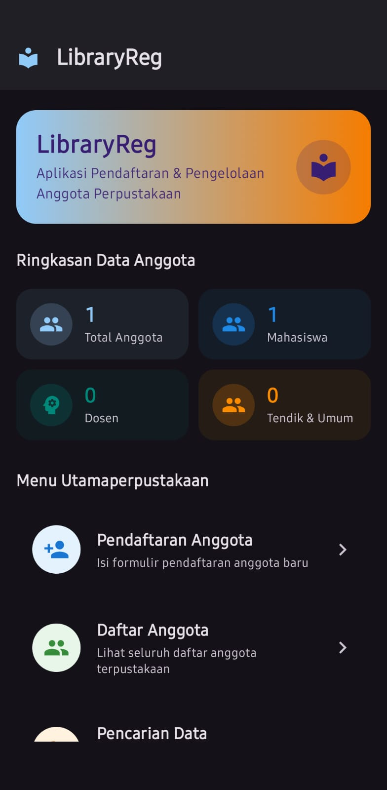
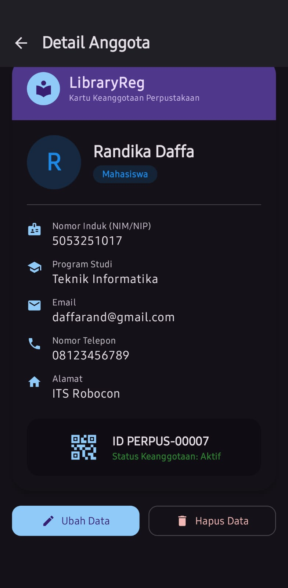

# LibraryReg: Aplikasi Pendaftaran & Pengelolaan Anggota Perpustakaan


**LibraryReg** adalah aplikasi Android menggunakan **Jetpack Compose (Material Design 3)** yang dirancang untuk menyederhanakan proses pendaftaran serta pengelolaan data anggota perpustakaan.

---

## Soal 1. Deskripsi & Ruang Lingkup Aplikasi

### Deskripsi Studi Kasus
Proses pendaftaran dan pengelolaan anggota perpustakaan lembaga umum masih dilakukan secara manual. Sistem manual ini menimbulkan berbagai kendala utama sebagai berikut:
- **Antrian yang Panjang:** Calon anggota harus mengantri dan mengisi form kertas secara manual.
- **Kesalahan Pencatatan Data:** Resiko data tidak lengkap, typo, atau berkas hilang.
- **Lamanya Proses Pencarian:** Petugas memerlukan waktu lama untuk mencari berkas anggota secara manual di tumpukan arsip.
- **Lambatnya Pembuatan Kartu Anggota:** Verifikasi dan penerbitan kartu memerlukan waktu berhari-hari.

**Solusi Aplikasi LibraryReg:**
Aplikasi **LibraryReg** hadir sebagai solusi berbasis mobile  yang memungkinkan calon anggota dan petugas perpustakaan melakukan pendaftaran, pencarian, perubahan, serta penghapusan data anggota secara realtime.

---

### Ruang Lingkup Aplikasi

1. **Fitur Formulir Pendaftaran Anggota:**
   - Input data diri calon anggota meliputi:
     * Nama Lengkap
     * Nomor ID (NRP untuk Mahasiswa / NIP untuk Dosen/Tendik / No. KTP untuk Umum)
     * Program Studi / Unit Kerja
     * Alamat Lengkap
     * Nomor Telepon / WhatsApp
     * Email
     * Jenis Keanggotaan (Mahasiswa, Dosen, Tendik, Umum)

2. **Sistem Validasi Data Input:**
   - **Pengecekan Field Required:** Memastikan tidak ada field utama yang kosong.
   - **Validasi Format Email:** Menggunakan pattern email untuk cek alamat email yang valid.
   - **Validasi Nomor ID:** Memeriksa minimal panjang digit serta pengecekan keunikan (mencegah pendaftaran ganda/NRP duplikat).
   - **Pesan Indikator Visual Error:** Menampilkan pesan error pada komponen TextField.

3. **Manajemen Data Anggota / CRUD (Create, Read, Update, Delete):**
   - **Create:** Pendaftaran anggota baru dengan validasi.
   - **Read:** Menampilkan daftar anggota menggunakan `LazyColumn`, filter, dan fitur pencarian kata (*search bar*).
   - **Update:** Pengubahan data anggota yang terdaftar melalui form.
   - **Delete:** Penghapusan data anggota yang dilengkapi dengan dialog konfirmasi.
   - **Kartu Keanggotaan:** Tampilan profil Kartu Anggota Perpustakaan lengkap

4. **Batasan Sistem 
   - **Penyimpanan Data:** Menggunakan Room Database Local Cache.
   - **Autentikasi:** Pengelolaan dilakukan dalam satu peran user (Petugas Perpustakaan/Administrator).

---

##  Soal 2. Desain UI / User Interface




## 🛠️ Soal 3. Implementasi, Dokumentasi, dan Video Demo

### Data

Data Model Utama (`Member.kt`):

```kotlin
data class Member(
    val id: Int = 0,               
    val namaLengkap: String,       
    val nomorInduk: String,        
    val programStudi: String,      
    val alamat: String,            
    val nomorTelepon: String,      
    val email: String,             
    val jenisKeanggotaan: String  
)
```

---


**Link Video Demo:**

#### Skenario Demo yang Ditunjukkan dalam Video:
1. **Demo Form & Validasi Real-time:**
   - Pengujian input kolom kosong, kesalahan format email (tanpa `@`), dan input NIM kurang dari 5 digit.
   - Penampilan pesan indikator error berwarna merah secara otomatis.
   - Pendaftaran anggota baru hingga muncul *Snackbar notification*.
2. **Demo Dashboard & Statistik:**
   - Pembaruan angka statistik (Total, Mahasiswa, Dosen, Tendik/Umum) secara otomatis saat data bertambah.
3. **Demo Real-time Search & Filter:**
   - Pencarian cepat anggota berdasarkan Nama dan NIM.
   - Penyaringan menggunakan *FilterChip* Jenis Keanggotaan.
4. **Demo Kelola Data (CRUD & Delete Dialog):**
   - Mengubah (Edit) data anggota terdaftar.
   - Menghapus data anggota dengan dialog konfirmasi (`ConfirmDeleteDialog`).
5. **Demo Kartu Anggota Digital:**
   - Membuka Kartu Anggota Digital Perpustakaan lengkap dengan ID Digital & QR Code.

---

### 📄 Lisensi
Hak Cipta © 2025 **LibraryReg Project**. Dikembangkan untuk tugas ETS Android Development.
