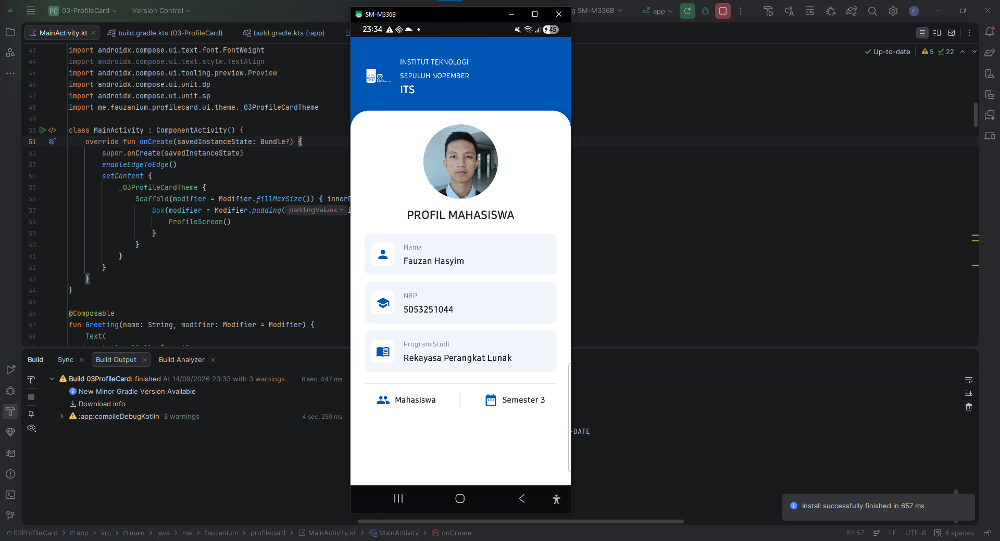

## Deskripsi Singkat
Aplikasi Android sederhana untuk autentikasi login pengguna menggunakan Jetpack Compose, arsitektur MVVM, dan Room Database sebagai penyimpanan lokal.

## Arsitektur Aplikasi
Penjelasan alur aliran data: UI (Compose) -> ViewModel -> Repository -> DAO -> Room Database (SQLite).

1. **UI (Jetpack Compose)**: Membaca StateFlow dari ViewModel dan mengalirkan event aksi pengguna.
2. **ViewModel**: Mengelola state input serta state autentikasi dan mengeksekusi logika login melalui Coroutines.
3. **Repository**: Mengabstraksi sumber data dan menjadi perantara antara ViewModel dan DAO.
4. **DAO (Data Access Object)**: Mengeksekusi query SQL terhadap Room Database secara asynchronous.
5. **Room Database (SQLite)**: Menyimpan entitas data pengguna pada basis data SQLite lokal.

## Potongan Kode Penting dan Penjelasan

**1. Entity Data User (User.kt)**

Anotasi **@Entity** menandai kelas sebagai tabel SQLite dengan nama **users**. Anotasi **@PrimaryKey(autoGenerate = true)** menentukan bahwa kolom **id** berfungsi sebagai kunci utama dengan nilai otomatis.

```kotlin
@Entity(tableName = "users")
data class User(
    @PrimaryKey(autoGenerate = true)
    val id: Int = 0,
    val username: String,
    val password: String
)
```

**2. Data Access Object (UserDao.kt)**

Interface **UserDao** berisi kueri SQL untuk operasi database. Fungsi **login()** menerima parameter **username** dan **password** serta mengembalikan objek **User?** bertipe nullable. Mengembalikan objek **User** jika pencocokan data ditemukan dan **null** jika data tidak ditemukan.

```kotlin
@Dao
interface UserDao {
    @Insert(onConflict = OnConflictStrategy.REPLACE)
    suspend fun insert(user: User)

    @Query("SELECT * FROM users WHERE username = :username AND password = :password LIMIT 1")
    suspend fun login(username: String, password: String): User?
}
```

**3. Pengelolaan State dan Logika Login (LoginViewModel.kt)**

Fungsi **login()** pada **LoginViewModel** menjalankan fungsi autentikasi dari **UserRepository** di dalam **viewModelScope.launch**. Mutasi state UI dilakukan dengan memperbarui **_loginState** menjadi **LoginState.Success** jika data ditemukan atau **LoginState.Error** jika data salah.

```kotlin
fun login() {
    val currentUsername = _username.value.trim()
    val currentPassword = _password.value.trim()

    viewModelScope.launch {
        val user = repository.login(currentUsername, currentPassword)
        if (user != null) {
            _loginState.value = LoginState.Success(
                message = "Login Berhasil! Selamat datang, ${user.username}",
                username = user.username
            )
        } else {
            _loginState.value = LoginState.Error("Username atau Password Salah! Coba lagi")
        }
    }
}
```

**4. Antarmuka Form dan Feedback UI (LoginScreen.kt)**

Pada **LoginScreen**, event klik pada tombol login memanggil **viewModel.login()**. Komponen **when (val state = loginState)** merender **Card** hijau secara kondisional untuk **LoginState.Success** dan **Card** merah untuk **LoginState.Error**.

```kotlin
// Event klik tombol login
Button(
    onClick = { viewModel.login() },
    modifier = Modifier
        .fillMaxWidth()
        .height(50.dp)
) {
    Text(text = "LOGIN", fontWeight = FontWeight.Bold)
}

// Rendering kondisional feedback status
when (val state = loginState) {
    is LoginState.Success -> {
        Card(
            modifier = Modifier.fillMaxWidth(),
            colors = CardDefaults.cardColors(containerColor = Color(0xFFE8F5E9)),
            border = BorderStroke(1.dp, Color(0xFFA5D6A7))
        ) {
            Row(modifier = Modifier.padding(16.dp)) {
                Icon(Icons.Filled.CheckCircle, contentDescription = null, tint = Color(0xFF2E7D32))
                Text(text = "Login Berhasil!\nSelamat datang, ${state.username}")
            }
        }
    }
    is LoginState.Error -> {
        Card(
            modifier = Modifier.fillMaxWidth(),
            colors = CardDefaults.cardColors(containerColor = Color(0xFFFFEBEE)),
            border = BorderStroke(1.dp, Color(0xFFEF9A9A))
        ) {
            Row(modifier = Modifier.padding(16.dp)) {
                Icon(Icons.Filled.Cancel, contentDescription = null, tint = Color(0xFFC62828))
                Text(text = "Username atau Password Salah!\nCoba lagi")
            }
        }
    }
    LoginState.Idle -> {}
}
```

## Data Testing

akun dummy database:
**Username**: admin
**Password**: 12345
