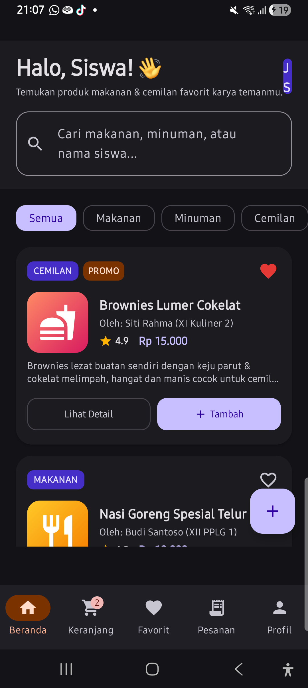
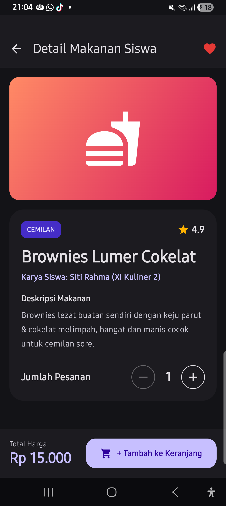
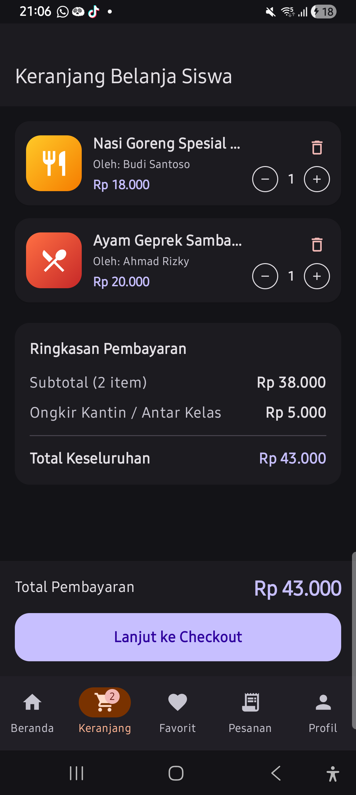

# MarketSiswa Food Ordering App

## Deskripsi Aplikasi
MarketSiswa Food Ordering adalah aplikasi Android pemesanan makanan berbasis karya siswa yang dibangun menggunakan ekosistem Kotlin, Jetpack Compose, Material Design 3, dan arsitektur MVVM.


## Fitur Utama dan Tampilan UI

**1. Beranda dan Filter Kategori**
Menampilkan daftar makanan siswa, kolom pencarian, dan filter kategori.



**2. Detail Makanan dan Keranjang Belanja**
Menampilkan rincian produk, jumlah porsi, serta manajemen item keranjang belanja.\




**3. Checkout dan Konfirmasi Pesanan**
Formulir alamat pengiriman, metode pembayaran, dan rincian transaksi.




**4. Navigasi dan Mode Tema**
Beralih halaman dengan NavigationBar

## Arsitektur Sistem
Pengembangan menggunakan pola MVVM dengan alur UI (Compose MD3) -> ViewModel (StateFlow) -> Repository -> Data Layer (Room/Local Data).

## Potongan Kode Penting dan Penjelasan

**1. Data Model Produk Makanan (FoodItem.kt)**
```kotlin
data class FoodItem(
    val id: String,
    val name: String,
    val description: String,
    val price: Double,
    val category: FoodCategory,
    val sellerName: String,
    val sellerClass: String = "RPL",
    val rating: Double = 4.8,
    val isPromo: Boolean = false,
    val iconName: String = "food"
)
```
Model data ini merepresentasikan struktur objek makanan buatan siswa yang mencakup identitas produk, harga, kategori, informasi penjual, rating, dan status promo.

**2. State Management Keranjang (FoodViewModel.kt)**
```kotlin
fun addToCart(product: FoodItem, quantity: Int = 1) {
    repository.addToCart(product.id, quantity)
    _addedToCartFeedback.value = product
    _snackbarMessage.value = "${product.name} berhasil ditambahkan ke keranjang!"
}

val cartTotal: StateFlow<Double> = cartSubtotal.combine(cartSubtotal) { subtotal, _ ->
    if (subtotal > 0) subtotal + shippingFee else 0.0
}.stateIn(
    scope = viewModelScope,
    started = SharingStarted.WhileSubscribed(5000),
    initialValue = 0.0
)
```
Fungsi addToCart memperbarui data keranjang pada repository dan memicu notifikasi feedback. StateFlow cartTotal menghitung total biaya secara reaktif berdasarkan gabungan subtotal dan biaya pengiriman.

**3. Komponen Card Produk Material 3 (FoodCard.kt)**
```kotlin
Card(
    modifier = modifier
        .fillMaxWidth()
        .clickable { onCardClick() },
    shape = RoundedCornerShape(20.dp),
    colors = CardDefaults.cardColors(
        containerColor = MaterialTheme.colorScheme.surface
    ),
    elevation = CardDefaults.cardElevation(defaultElevation = 2.dp)
) {
    // Tata letak konten card produk
}
```
Komponen ini memanfaatkan komponen Card dari Material 3 dengan warna surface dari colorScheme, sudut melengkung 20dp, dan elevasi 2dp untuk menyajikan informasi makanan secara terstruktur.

**4. Konfigurasi Tema Dinamis (Theme.kt)**
```kotlin
@Composable
fun Tugas11FoodOrderTheme(
    darkTheme: Boolean = isSystemInDarkTheme(),
    content: @Composable () -> Unit
) {
    val colorScheme = if (darkTheme) DarkColorScheme else LightColorScheme

    MaterialTheme(
        colorScheme = colorScheme,
        typography = Typography,
        content = content
    )
}
```
Fungsi Composable ini mengatur alur pergantian tema aplikasi antara DarkColorScheme dan LightColorScheme sesuai kondisi state darkTheme yang aktif pada MaterialTheme.
