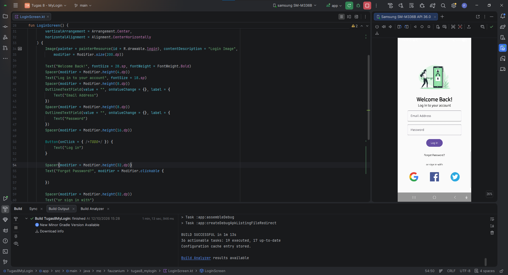

# LoginScreen (Jetpack Compose)



Function `LoginScreen` adalah function composable yang menampilkan halaman login. Seluruh elemen UI disusun secara vertikal di tengah layar menggunakan `Column`. 

Page ini terdiri dari:

1. Gambar Ilustrasi
3. Input email dan password
4. Tombol login
5. Teks "Forgot Password?"
6. Opsi sign in dengan akun Google, Facebook, Twitter
  <br/>


## 1. Root Layout: Column

```kotlin
Column(
    modifier = Modifier.fillMaxSize(),
    verticalArrangement = Arrangement.Center,
    horizontalAlignment = Alignment.CenterHorizontally
) {
```

- `Modifier.fillMaxSize()` membuat `Column` memenuhi seluruh lebar dan tinggi layar.
- `verticalArrangement = Arrangement.Center` memusatkan seluruh isi secara vertikal.
- `horizontalAlignment = Alignment.CenterHorizontally` memusatkan setiap child secara horizontal.

## 2. Gambar Header

```kotlin
Image(painter = painterResource(id = R.drawable.login), contentDescription = "Login Image",
    modifier = Modifier.size(200.dp))
```

`Image` menampilkan gambar dari folder `res/drawable`.

- `painterResource(id = R.drawable.login)` memuat resource bernama `login`.
- `contentDescription` dipakai oleh screen reader untuk aksesibilitas.
- `Modifier.size(200.dp)` mengatur lebar dan tinggi gambar menjadi 200 dp.

## 3. Judul dan Subjudul

```kotlin
Text("Welcome Back!", fontSize = 28.sp, fontWeight = FontWeight.Bold)
Spacer(modifier = Modifier.height(4.dp))
Text("Log in to your account", fontSize = 18.sp)
Spacer(modifier = Modifier.height(8.dp))
```

- `Text` pertama adalah judul dengan ukuran 28 sp dan ketebalan bold.
- `Text` kedua adalah subjudul dengan ukuran 18 sp.
- `Spacer` dengan `Modifier.height(...)` dipakai untuk memberi jarak vertikal antar elemen. Satuan `dp` dipakai untuk ukuran layout, sedangkan `sp` dipakai untuk ukuran teks.

## 4. Input Field Email dan Password

```kotlin
OutlinedTextField(value = "", onValueChange = {}, label = {
    Text("Email Address")
})
Spacer(modifier = Modifier.height(8.dp))
OutlinedTextField(value = "", onValueChange = {}, label = {
    Text("Password")
})
Spacer(modifier = Modifier.height(16.dp))
```

`OutlinedTextField` adalah text field dengan garis tepi (outline) sesuai Material Design.

- `value` adalah teks yang sedang ditampilkan di field.
- `onValueChange` adalah callback yang dipanggil saat pengguna mengetik.
- `label` adalah teks petunjuk yang berpindah ke atas ketika field difokuskan.

Pada kode saat ini `value` bernilai string kosong tetap dan `onValueChange` kosong, sehingga field belum bisa diisi. Lihat bagian Catatan.

## 5. Tombol Login

```kotlin
Button(onClick = { /*TODO*/ }) {
    Text("Log in")
}
```

`Button` adalah komponen tombol Material. Parameter `onClick` menerima lambda yang dijalankan saat tombol ditekan.

## 6. Teks Forgot Password

```kotlin
Spacer(modifier = Modifier.height(32.dp))
Text("Forgot Password?", modifier = Modifier.clickable {

})
```

`Modifier.clickable` membuat `Text` dapat ditekan.

## 7. Teks Pemisah

```kotlin
Spacer(modifier = Modifier.height(32.dp))
Text("or sign in with")
Spacer(modifier = Modifier.height(32.dp))
```

## 8. Ikon Social Login

```kotlin
Row(
    modifier = Modifier.fillMaxWidth(),
    horizontalArrangement = Arrangement.SpaceEvenly
) {
    Image(painter = painterResource(id = R.drawable.google), contentDescription = "Login Image",
        modifier = Modifier.size(48.dp))
    Image(painter = painterResource(id = R.drawable.facebook), contentDescription = "Login Image",
        modifier = Modifier.size(48.dp))
    Image(painter = painterResource(id = R.drawable.twitter), contentDescription = "Login Image",
        modifier = Modifier.size(48.dp))
}
```

`Row` menyusun child secara horizontal.

- `Modifier.fillMaxWidth()` membuat `Row` selebar layar.
- `Arrangement.SpaceEvenly` membagi ruang kosong secara merata di antara dan di sekitar ketiga ikon.
- Setiap `Image` menampilkan logo Google, Facebook, dan Twitter berukuran 48 dp dari `res/drawable`.
