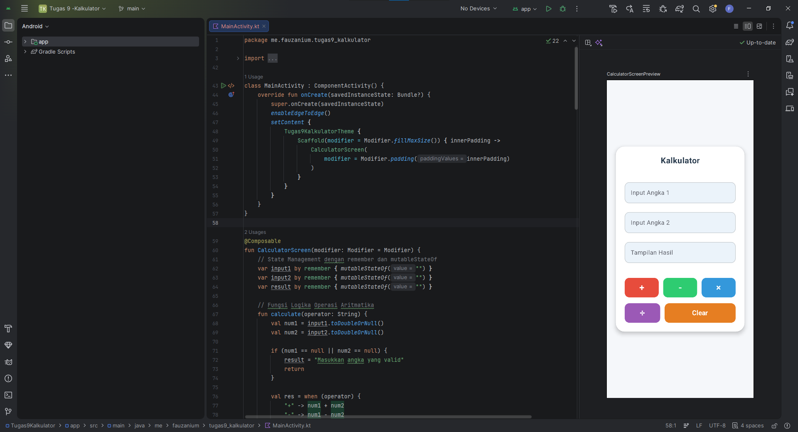

## Fitur Utama
1. Input Angka 1 dan Angka 2 menggunakan kolom input teks.
2. Tampilan Hasil perhitungan (read-only).
3. Operasi aritmatika dasar:
   - Penjumlahan (+)
   - Pengurangan (-)
   - Perkalian (x)
   - Pembagian (/)
4. Tombol Clear untuk mengosongkan seluruh input dan hasil.
5. Penanganan validasi input tidak valid dan pembagian dengan angka nol.

---

## Penjelasan Komponen dan Penggalan Kode

### 1. State
Penyimpanan nilai input dan hasil perhitungan menggunakan `remember` dan `mutableStateOf` agar antarmuka diperbarui secara otomatis ketika data berubah.

```kotlin
var input1 by remember { mutableStateOf("") }
var input2 by remember { mutableStateOf("") }
var result by remember { mutableStateOf("") }
```

### 2. Input Text Field
Menggunakan `OutlinedTextField` untuk menerima input berupa angka dari pengguna dan menampilkan hasil perhitungan.

```kotlin
OutlinedTextField(
    value = input1,
    onValueChange = { input1 = it },
    label = { Text("Input Angka 1") },
    placeholder = { Text("Masukkan angka...") },
    keyboardOptions = KeyboardOptions(keyboardType = KeyboardType.Decimal),
    singleLine = true,
    modifier = Modifier.fillMaxWidth()
)
```

### 3. Logika Operasi Aritmatika dan Reset
Fungsi `calculate` memproses perhitungan matematika berdasarkan operator yang dipilih, sedangkan fungsi `clearAll` mengosongkan nilai input dan hasil.

```kotlin
fun calculate(operator: String) {
    val num1 = input1.toDoubleOrNull()
    val num2 = input2.toDoubleOrNull()

    if (num1 == null || num2 == null) {
        result = "Masukkan angka yang valid"
        return
    }

    val res = when (operator) {
        "+" -> num1 + num2
        "-" -> num1 - num2
        "*" -> num1 * num2
        "/" -> {
            if (num2 == 0.0) {
                result = "Tidak dapat membagi dengan 0"
                return
            } else {
                num1 / num2
            }
        }
        else -> 0.0
    }

    result = if (res % 1.0 == 0.0) {
        res.toLong().toString()
    } else {
        res.toString()
    }
}

fun clearAll() {
    input1 = ""
    input2 = ""
    result = ""
}
```

### 4. Container dan Layout UI
Menggunakan `Box` dan `Card` sebagai kontainer utama untuk membungkus seluruh elemen antarmuka secara rapi di tengah layar.

```kotlin
Box(
    modifier = modifier
        .fillMaxSize()
        .background(Color(0xFFF5F7FA))
        .padding(16.dp),
    contentAlignment = Alignment.Center
) {
    Card(
        modifier = Modifier.fillMaxWidth(),
        shape = RoundedCornerShape(24.dp)
    ) {
        // Elemen UI disusun di dalam Column
    }
}
```
